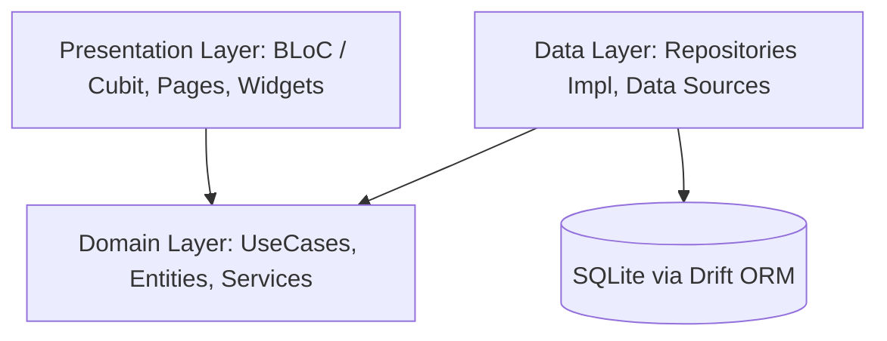

# BÁO CÁO TIẾN ĐỘ & GIỚI THIỆU ỨNG DỤNG CHIAPAY

> **Đề tài:** Xây dựng ứng dụng di động ChiaPay hỗ trợ quản lý và quyết toán chi phí nhóm trên nền tảng Flutter  
> **Tài liệu tham chiếu:** [ChiaPay.pdf](file:///C:/ChiaPay/chia_pay/ChiaPay.pdf)  
> **Thời gian cập nhật:** 08/11/2026  
> **Tình trạng tổng quan:** **Đã hoàn thành 100% phạm vi MVP cốt lõi & các phân hệ mở rộng cơ bản; 37/37 Unit Test đạt chuẩn.**

---

## 1. Giới thiệu tổng quan về ứng dụng ChiaPay

### 1.1. Bài toán thực tế
Khi đi du lịch, liên hoan ăn uống, ở ghép hoặc sinh hoạt câu lạc bộ cùng nhau, việc thanh toán và tính toán chi phí thường gặp nhiều khó khăn:
- Nhiều người thay phiên nhau thanh toán các khoản khác nhau (tiền phòng, tiền xe, tiền ăn uống,...).
- Thành viên tham gia từng khoản không giống nhau (có khoản cả nhóm cùng chịu, có khoản chỉ một vài người tham gia).
- Việc tính nhẩm hoặc ghi sổ thủ công rất dễ sai sót, gây bất tiện, khó xử và mất thời gian đối chiếu.
- Chuyển tiền qua lại theo từng hóa đơn tạo ra quá nhiều giao dịch rườm rà.

### 1.2. Định hướng và Giá trị cốt lõi của ChiaPay
**ChiaPay** không đơn thuần chỉ là một ứng dụng ghi chép chi tiêu cá nhân, mà là giải pháp toàn diện cho bài toán tài chính nhóm:
1. **Minh bạch tuyệt đối:** Mọi khoản chi đều gắn liền với người thanh toán, danh sách người thụ hưởng, cách chia và lịch sử chỉnh sửa rõ ràng.
2. **Tự động tính toán:** Tự động tính số tiền đã ứng, chi phí phải chịu, số dư lý thuyết và số tiền thực tế còn phải thanh toán của từng thành viên.
3. **Tối ưu hóa hoàn tiền (Smart Settlement):** Áp dụng giải thuật cân bằng nợ tự động ghép cặp người nợ và người nhận, giảm tối đa số lần chuyển tiền trong nhóm (tối đa chỉ $N - 1$ giao dịch cho $N$ thành viên).
4. **Hoạt động ngoại tuyến (Offline-First):** Không yêu cầu tài khoản, không cần kết nối máy chủ hay Internet. Dữ liệu được bảo toàn an toàn trên thiết bị của người dùng, tôn trọng tối đa quyền riêng tư.

---

## 2. Kiến trúc phần mềm & Công nghệ áp dụng

Ứng dụng được thiết kế theo các tiêu chuẩn công nghệ hiện đại, đảm bảo tính mở rộng và dễ bảo trì:

- **Framework:** Flutter 3.x (Dart SDK ^3.10.4) với giao diện Material 3 hiện đại.
- **Kiến trúc:** Clean Architecture chia 3 tầng tách biệt (*Presentation - Domain - Data*).
- **Quản lý trạng thái (State Management):** `flutter_bloc` / `Cubit` độc lập, phản hồi nhanh.
- **Điều hướng:** `go_router` hỗ trợ deep-linking và luồng điều hướng mạch lạc.
- **Cơ sở dữ liệu cục bộ:** `Drift` (SQLite ORM) bật `foreign_keys = ON`, đảm bảo tính toàn vẹn dữ liệu qua transactions và hỗ trợ migrations.
- **Xử lý tài chính chính xác:** Toàn bộ giá trị tiền tệ được lưu dưới dạng số nguyên (`int`), triệt tiêu hoàn toàn lỗi làm tròn số thực (`floating-point error`).

---

## 3. Chi tiết các phần ĐÃ HOÀN THÀNH

Ứng dụng đã hoàn thành toàn diện 6 phân hệ chức năng cùng bộ kiểm thử tự động:

### 3.1. Phân hệ 1 – Quản lý nhóm (Hoàn thành 100%)
- **Quản lý danh sách nhóm:** Tạo và hiển thị các nhóm chi tiêu đa dạng (Du lịch, Ăn uống, Ở ghép, Gia đình...). Hỗ trợ chọn icon, màu sắc nhận diện và đơn vị tiền tệ riêng (VND, USD, EUR...).
- **Quản lý thành viên:** Thêm mới, chỉnh sửa tên thành viên. Hệ thống có cơ chế kiểm tra ràng buộc: không cho phép xóa thành viên đã tham gia vào các khoản chi để bảo vệ tính toàn vẹn của dữ liệu.
- **Tổng quan nhóm:** Banner hiển thị tổng chi tiêu, tiến độ quyết toán và danh sách chi tiết số dư của từng người.

### 3.2. Phân hệ 2 – Quản lý khoản chi (Hoàn thành 100%)
- **Thêm/Sửa/Xóa khoản chi:** Hỗ trợ nhập tên, số tiền, ngày chi, danh mục (Ăn uống, Đi lại, Khách sạn, Giải trí...) và ghi chú.
- **Linh hoạt đối tượng:** Người thanh toán có thể không nằm trong danh sách người thụ hưởng; hỗ trợ chọn nhiều người cùng chịu chi phí.
- **3 Cơ chế phân chia tiền tệ thông minh:**
  1. *Chia đều (Equal):* Tự động phân bổ phần dư lẻ sao cho tổng các phần chia luôn bằng đúng số tiền ban đầu (ví dụ: 100.000đ chia 3 người ra 33.334đ, 33.333đ, 33.333đ).
  2. *Chia theo số tiền tùy chỉnh (Exact):* Nhập số tiền cụ thể của từng người, tự động xác thực tổng tiền.
  3. *Chia theo tỷ lệ phần trăm (Percent):* Nhập tỷ lệ % từng người, tính toán quy đổi ra số nguyên chính xác.
- Tự động cập nhật lại số dư toàn nhóm ngay sau khi sửa hoặc xóa khoản chi.

### 3.3. Phân hệ 3 – Số dư và Quyết toán (Hoàn thành 100%)
- **Tự động cân bằng số dư:** UseCase độc lập [`CalculateBalancesUseCase`](file:///C:/ChiaPay/chia_pay/lib/domain/usecases/balance_usecases.dart#L7-L46) tính toán chính xác số tiền đã ứng (`paid`), phần chi phí phải chịu (`share`), số tiền đã trả (`sent`) và số tiền đã nhận (`received`).
- **Thuật toán đề xuất hoàn tiền tối ưu:** [`GenerateSettlementUseCase`](file:///C:/ChiaPay/chia_pay/lib/domain/usecases/balance_usecases.dart#L53-L93) phân nhóm người nợ và người nhận, ghép cặp tham lam (Greedy Matching) giữa khoản nợ lớn nhất và khoản cần nhận lớn nhất.
- **Theo dõi tiến độ quyết toán:** Tính toán tỷ lệ phần trăm hoàn tất công nợ của cả nhóm và hiển thị trực quan qua Progress Bar.

### 3.4. Phân hệ 4 – Theo dõi & Xác nhận hoàn tiền (Hoàn thành 100%)
- **Đánh dấu đã trả tiền:** Cho phép người dùng ghi nhận khi một thành viên đã chuyển khoản thực tế bên ngoài (ghi rõ ngày giờ, số tiền, ghi chú xác nhận).
- **Phân biệt hai loại số dư:**
  - *Số dư lý thuyết (`theoreticalBalance`):* Phản ánh nghĩa vụ gốc theo các hóa đơn.
  - *Số dư còn lại (`remainingBalance`):* Phản ánh số tiền thực tế còn phải trả/nhận sau khi đã trừ đi các lần thanh toán.
- **Hỗ trợ hoàn tác (Undo):** Cho phép xóa/hủy giao dịch hoàn tiền nếu ghi nhận nhầm lẫn.

### 3.5. Phân hệ 5 – Thống kê & Báo cáo (Hoàn thành 100%)
- **Biểu đồ trực quan:** Sử dụng `fl_chart` hiển thị biểu đồ phân bổ chi tiêu theo danh mục và biểu đồ diễn biến chi tiêu theo thời gian.
- **Bộ lọc thông minh:** Lọc khoản chi theo từng người trả tiền.
- **Xuất và chia sẻ dữ liệu:**
  - Xuất bảng chi tiêu chi tiết ra file **CSV** (được mã hóa UTF-8 với BOM, mở hiển thị tiếng Việt hoàn hảo trên Excel).
  - Tự động tạo văn bản tổng kết quyết toán định dạng đẹp để gửi nhanh qua Zalo, Messenger, SMS.

### 3.6. Phân hệ 6 – Cài đặt, Bảo mật & Dữ liệu (Hoàn thành 100%)
- **Bảo mật mã PIN:** Khóa ứng dụng bằng mã PIN 4 số, tự động yêu cầu mở khóa khi vào lại app.
- **Chế độ hiển thị:** Hỗ trợ giao diện Sáng (Light Mode), Tối (Dark Mode) hoặc tự động theo hệ thống.
- **Sao lưu & Khôi phục:** Xuất toàn bộ dữ liệu ra file `.json` và khôi phục nguyên vẹn trên bất kỳ thiết bị nào qua `FilePicker`.
- **Kho lưu trữ:** Hỗ trợ lưu trữ (Archive) các nhóm đã xong chuyến đi để giữ màn hình chính gọn gàng.

### 3.7. Kết quả kiểm thử tự động (Unit Test)
Hệ thống đã triển khai đầy đủ và vượt qua **37/37 Unit Test** bao quát tất cả 8 ca kiểm thử biên phức tạp được đề ra trong đặc tả:
- ✅ Chia đều khoản tiền lẻ không chia hết (100.000đ cho 3 người) không lệch 1 đồng.
- ✅ Người thanh toán không tham gia vào khoản chi.
- ✅ Thành viên mới được thêm vào sau khi nhóm đã có hóa đơn.
- ✅ Sửa hoặc xóa hóa đơn làm thay đổi số dư được tính toán lại chính xác từ dữ liệu gốc.
- ✅ Một người vừa cần nhận ở khoản này, vừa cần trả ở khoản khác được bù trừ 1 chiều duy nhất.
- ✅ Đánh dấu thanh toán rồi hoàn tác khôi phục số dư chuẩn xác.
- ✅ Tổng số dư của toàn bộ thành viên trong nhóm luôn bằng 0 tuyệt đối.
- ✅ Sao lưu và khôi phục toàn vẹn dữ liệu.

---

## 4. Kế hoạch & Định hướng phát triển trong tương lai

Dựa theo mục tiêu nâng cao của đề tài và mở rộng sản phẩm thực tế:

### 4.1. Giai đoạn 1: Hoàn thiện các tính năng nâng cao (Ưu tiên tiếp theo)
1. **Xuất báo cáo định dạng PDF:**
   - Tích hợp thư viện `pdf` / `printing` để tạo file PDF tổng kết chi phí và biên bản quyết toán có định dạng in ấn chuyên nghiệp (kèm logo, bảng tổng hợp, khu vực chữ ký xác nhận của các thành viên).
2. **Quét hóa đơn thông minh bằng OCR:**
   - Ứng dụng Google ML Kit (Text Recognition) hoặc Gemini API để chụp và bóc tách tự động tên hóa đơn, tổng tiền, ngày tháng trực tiếp vào biểu mẫu nhập liệu.
3. **Nâng cấp thuật toán quyết toán tối ưu tuyệt đối (Minimum Cash Flow):**
   - Áp dụng thuật toán quy hoạch động giải bài toán Subset-Sum đối với nhóm nhỏ ($N \le 10$) để tìm tập hợp triệt tiêu nợ cục bộ, giảm số giao dịch xuống dưới $N - 1$.

### 4.2. Giai đoạn 2: Tính năng mở rộng & Tiện ích người dùng
1. **Tích hợp mã QR thanh toán nhanh (VietQR):**
   - Cho phép thành viên lưu số tài khoản ngân hàng. Khi quyết toán, hệ thống tự động sinh mã VietQR kèm số tiền và nội dung chuyển khoản để người trả quét mã chuyển khoản 1 chạm qua ứng dụng ngân hàng.
2. **Đồng bộ ngang hàng bảo mật (P2P / Multi-device Sync):**
   - Cơ chế chia sẻ nhóm qua mã QR hoặc Bluetooth/Wi-Fi nội bộ mà không cần phụ thuộc vào máy chủ trung tâm.

---

## 5. Kết luận & Đánh giá mức độ hoàn thành

- **Tiến độ tổng thể:** Dự án đã hoàn thành **100% các yêu cầu bắt buộc (MVP)** và phân hệ 5, 6 mở rộng theo đề cương của tài liệu `ChiaPay.pdf`.
- **Chất lượng phần mềm:** Kiến trúc rõ ràng, thuật toán tính toán chặt chẽ không có sai số, giao diện trau chuốt, sẵn sàng cho việc trình diễn demo luồng thực tế và làm báo cáo đồ án môn học.
- **Chi tiết kiểm tra từng đầu việc:** Tham khảo thêm tại file checklist [TIEN_DO.md](file:///C:/ChiaPay/chia_pay/TIEN_DO.md).
